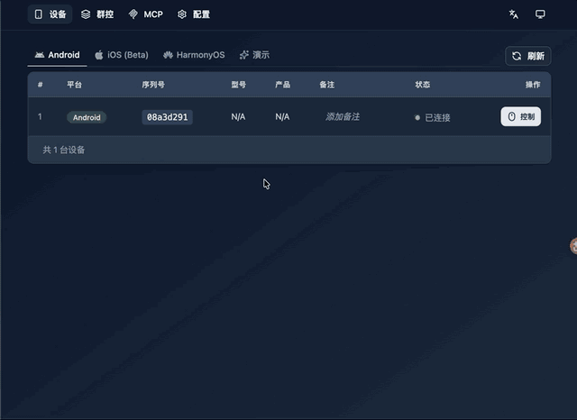

# uiautodev

A desktop app and web server for controlling Android, iOS and HarmonyOS phones from your computer, with support for controlling **multiple devices at once**.

Key features:

- View phone screens in real time and control them with mouse and keyboard: hardware keys, rotation, screen cropping, screenshot copying, screen recording and frame freezing
- Supports Android (scrcpy), iOS (WDA, beta) and HarmonyOS devices, plus a built-in demo device that needs no hardware
- Group control: watch and operate multiple devices at once in a single view
- Device clipboard: copy text (Android / HarmonyOS) and images (Android 10+) between the host and the device in both directions
- Element inspector: UI hierarchy tree with node attributes, XPath queries, and layout/screenshot export and import
- App management: see the foreground app, and list, start and stop apps through the API or MCP
- MCP server: exposes device control to AI and automation clients over Streamable HTTP and SSE, with a dedicated token
- Plugin extensibility: bundled plugins, manual install and a plugin market; plugins can add cards and tabs to the device page
- Web server: use it straight from the browser with Basic Auth, HTTPS, ngrok and isolated multi-instance state
- Clustering: master/slave cascading across machines, with push and direct connection modes plus remote adb connect
- Chinese/English UI, dark mode, and in-app update checks and installation



## Download and usage

The desktop app (macOS / Windows) and the server binaries for every platform can be downloaded from https://get.uiauto.dev.
The server can also be started directly with `npx uiautodev run`.

## Repository layout

| Directory | Description |
|-----------|-------------|
| Root | Desktop app and server source: `main.go`, `webserver/`, `cmd/`, `internal/`, `frontend/`, `build/` |
| `npm/` | The `uiautodev` npm package that downloads and runs the server binary, i.e. `npx uiautodev run` |
| `images/` | Documentation images |
| `docs/` | Documentation assets, update notes and design documents |

Pushing an `x.y.z` tag builds and publishes the desktop app and server via `.github/workflows/release.yml`; the npm package keeps its own version (independent of app tags) and is released by `.github/workflows/npm-release.yml` when `npm/` changes.

## iOS helper binary

`ios` is fairly large, so it is no longer bundled in the installer. The first time you use an iOS feature it is downloaded from
`https://dl.uiauto.dev/binaries/<os>/ios` and cached in
`~/Library/Application Support/uiautodev/bin/` (`%LOCALAPPDATA%\uiautodev\bin` on Windows). If `ios` already exists in your system PATH, that one is used instead.

## uiautodev-server command line flags

| Flag | Default | Description |
|------|---------|-------------|
| `-addr` | `localhost:33299` | HTTP listen address |
| `-open` | | Open the home page in a browser after the server starts (when `-addr` is of the form `:port`, opens `http://localhost:port/`) |
| `-auth <user:pass>` | | Basic auth credentials (can be specified multiple times) |
| `-proxy-log <file>` | | Proxy log path (no logging when empty) |
| `-config-dir <dir>` | `~/.config/uiautodev` | Config directory holding `config.json` and the default plugin directory `<config-dir>/plugins`; use it to isolate state when running several servers |
| `-plugin-dir <dir>` | `<config-dir>/plugins` | Directory where user plugins are installed and loaded (highest priority; a plugin with the same name overrides older/bundled ones) |
| `-tls-addr <addr>` | | HTTPS listen address (an HTTP redirect listener is started on `-addr` at the same time) |
| `-tls-cert <file>` | | TLS certificate file (PEM) |
| `-tls-key <file>` | | TLS private key file (PEM) |
| `-ngrok` | | Expose the server publicly through ngrok |
| `-ngrok-authtoken <token>` | | ngrok authtoken (can also be set with the `NGROK_AUTHTOKEN` environment variable) |
| `-master-url <url>` | | HTTP(S) address of the upstream master, e.g. `https://master.example.com`; when set, this node joins it as a slave but is still a master itself. Only the origin is needed, the path is filled in automatically |
| `-token <token>` | | Slave token generated by the master; can also be set with the `UIAUTODEV_CLUSTER_TOKEN` environment variable |
| `-name <name>` | machine hostname | Display name of the slave (optional) |
| `-master-insecure` | | Skip master certificate verification (when the master uses a self-signed certificate) |
| `-disable-device-listing` | | Disable the device listing API (security hardening) |
| `-verbose` | | Enable debug logging |
| `-version` | | Print the version and exit |

```sh
# Start the server and open the browser
uiautodev-server -open

# Use a specific port
uiautodev-server -addr :8080 -open
```

## Cluster mode (Master / Slave)

Every node (`uiautodev-server` and the desktop app) is a master by default. It aggregates the devices of all online slaves and exposes them through its own UI, API, MCP and `adb connect`. A node can also join another master as a slave, so masters can be chained.

Two connection modes are supported:

- **Classic mode**: the slave connects out to the master. Best when the slave is on a private network and the master has a public address.
- **Direct mode**: the master connects to a public slave over HTTP(S) + Basic Auth. Best when the slave has a public address and the master is on a private network. Direct mode needs no extra startup flags on the slave, and older slaves can join as well.

### Master

Cluster support is enabled by default on every node, no extra flags needed:

```sh
uiautodev-server -addr :33299 -auth admin:pass
```

The desktop app also embeds a master, but it only listens on `localhost`, so it can only accept slaves on the same machine or reached through a tunnel / port mapping.

Add slaves in the "Remote nodes" section of the Web settings page. Classic mode generates a one-time token (shown only once; the master stores just its hash); direct mode asks for the slave URL and Basic Auth credentials.

By default the master only shows the devices of the slave itself; devices of nodes connected below that slave are not aggregated upwards (to avoid duplicates and loops). To cascade, enable "Include downstream devices" on the slave entry and the master will also show the devices that slave aggregates. Cascading works over multiple levels, but every hop needs it enabled on that node; chains are built from node identities (`cluster.node_id` in `config.json`) for loop detection, so masters connected to each other or forming a cycle never produce duplicate devices.

ADB relay defaults:

- Listens on `0.0.0.0`
- Public host is taken from the request's Host header
- Port range `20000-20100`
- TTL 1 hour (sliding: renewed on each refresh every 5 minutes while active), idle 30 minutes (only applies when there is no active adb connection at all)

Override them in `config.json` only; there are no command line flags:

```json
{
  "cluster": {
    "adb_relay": {
      "bind": "0.0.0.0",
      "public_host": "",
      "port_range": [20000, 20100],
      "ttl": "1h",
      "idle_timeout": "30m",
      "allow_same_ip_only": true,
      "allowed_cidrs": []
    }
  }
}
```

Open the TCP ports in `port_range` in your firewall / security group when deploying, otherwise remote `adb connect` cannot reach the relay.

### Slave (classic mode)

```sh
# Tunnel only (recommended for production, no local HTTP port exposed)
npx uiautodev run -master-url https://master.example.com -token u-xxxxxx-xxxxxxxxxxxxxxxxxxxx -addr ""

# Also keep the local UI for debugging
npx uiautodev run -master-url https://master.example.com -token u-xxxxxx-xxxxxxxxxxxxxxxxxxxx -addr 127.0.0.1:33299
```

- Passing `-master-url` joins the current node to a master as a slave; no separate `-slave` switch is needed.
- After joining, the node is still a master itself, so you can keep adding your own slaves under "Remote nodes" (cascading).
- `-master-url` only accepts an `http://` or `https://` origin; the app appends `/api/v1/cluster/connect` and converts it to `ws/wss`.
- `-name` is optional and defaults to the machine hostname.
- `-addr ""` means no local HTTP listener at all, tunnel only.
- Prefer the `UIAUTODEV_CLUSTER_TOKEN` environment variable for the token so it does not show up in `ps`.
- Do not use `-auth` when joining an upstream (requests inside the tunnel are authenticated by the master). If the local listener needs auth, run a separate instance or drop `-master-url`.
- Add `-master-insecure` on the slave when the master uses a self-signed certificate.

### Direct mode (master connects to a public slave)

Start the slave as an ordinary service, exposing the default `33299` port with Basic Auth enabled:

```sh
uiautodev-server -addr 0.0.0.0:33299 -auth user:pass
```

On the master, choose "Master direct" under "Remote nodes" in the Web settings page and fill in:

- The slave address, e.g. `https://slave.example.com:33299`
- Basic Auth username / password
- "Skip TLS certificate verification" when using a self-signed certificate

Notes:

- A slave in direct mode just runs as an ordinary service; no `-master-url` or any cluster flag is needed. An older slave works as long as it exposes the standard API with Basic Auth.
- The master must be able to reach the slave's `33299` port; the slave firewall only needs to allow the master IP.
- In direct mode all device traffic (device list, operations, screenshots, screen streams, `/proxy/devices/...`, `adb connect`) is proxied by the master.
- For direct ADB, the master connects to the host from the slave URL on the adbkit port, so the slave firewall must allow the master IP on the adbkit port range (adbkit listens on `:<port>`). If the slave URL goes through a reverse proxy, make sure the adbkit ports of that host are reachable too, or use an address that reaches the slave directly.
- `HTTP` transmits Basic Auth credentials in plain text; use HTTPS in production (`-tls-addr` / `-tls-cert` / `-tls-key`) or a TLS reverse proxy.
- The slave cannot use `-disable-device-listing`, otherwise the master cannot aggregate its devices.

### Remote adb connect

Calling `GET /api/v1/devices/<remote-id>/connect` on the master returns:

```json
{
  "type": "tcp",
  "transport": "adb",
  "endpoint": "master.example.com:20000"
}
```

Just connect to the address returned by the master:

```sh
adb connect master.example.com:20000
adb devices
```

Notes:

- ADB over TCP is a plain text protocol; limit exposure with firewalls, `allowed_cidrs` and short TTLs.
- By default `allow_same_ip_only` only allows the source IP that issued the `/connect` request to connect to the relay; if the browser and the adb client use different egress IPs, configure `allowed_cidrs` or turn the restriction off.
- If the master sits behind Nginx/Caddy, the reverse proxy only handles HTTPS/WSS; the raw TCP ports of the ADB relay must be opened separately, port 443 alone is not enough.
- When proxying the tunnel with Nginx, support the WebSocket Upgrade header, a long `proxy_read_timeout`, and disable buffering.

### Notes

- The desktop app has a built-in master, but it only listens on `localhost`, so it can reach slaves in direct mode and cannot act as a slave; joining an upstream master requires `uiautodev-server -master-url`.
- Rotating a token or deleting a slave on the master closes the old connection immediately; the slave reconnects automatically (update its config when a new token is issued).
- When a slave goes offline its devices are marked unavailable on the master and refreshed automatically once it reconnects.

## MCP authentication

MCP (Model Context Protocol) uses a **separate long-lived token**, independent of the login credentials (`-auth` username/password or JWT).

- Set or randomly generate it under "MCP settings" in the Web settings page, or edit `mcp_token` in `config.json` directly.
- When `-auth` is enabled and `mcp_token` is empty, one is **generated automatically** at startup (with a `ua-` prefix).
- Clients access `/mcp/*` with `?token=<mcp_token>` or `Authorization: Bearer <mcp_token>`.
- When it is empty: if `-auth` is enabled, `/mcp/*` falls back to login auth (JWT / Basic); otherwise `/mcp/*` is fully open.
- Changes take effect immediately, no restart needed; rotate it by regenerating and saving in the settings page.

## Sponsor

If this project helps you, you are welcome to buy me a coffee ☕

- [Afdian](https://afdian.com/a/codeskyblue)

## Development

See [DEVELOP.md](DEVELOP.md) for building, debugging, packaging, signing and release (in Chinese).

## LICENSE

This project is licensed under the [MIT License](LICENSE).
