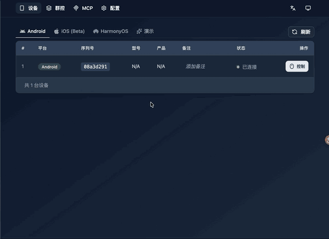

# uiautodev

[中文](README.md) | [English](README.en.md)

使用电脑方便地控制安卓（Android）、iOS、鸿蒙（HarmonyOS）手机的桌面应用与 Web 服务端，支持**批量控制**多台设备。

主要特性：

- 在电脑上实时查看并操作 Android / iOS / HarmonyOS 手机屏幕，支持多设备群控
- UI 层级树、XPath 查询、应用管理与设备剪贴板
- MCP Server：让 AI / 自动化客户端直接操作设备
- 插件扩展，以及可直接在浏览器使用的 Web 服务端
- 集群聚合、多用户设备占用、中英文界面与暗黑模式



## 下载与使用

桌面端（macOS / Windows）以及各平台服务端二进制都可以从 https://get.uiauto.dev 下载。
服务端也可以直接用 `npx uiautodev run` 启动。

## 仓库结构

| 目录 | 说明 |
|------|------|
| 根目录 | 桌面端与服务端源码：`main.go`、`webserver/`、`cmd/`、`internal/`、`frontend/`、`build/` |
| `npm/` | `uiautodev` npm 包：下载并启动对应平台的服务端二进制，即 `npx uiautodev run` |
| `images/` | 文档图片 |
| `docs/` | 文档资源、更新说明与设计文档 |

桌面端与服务端推送 `x.y.z` tag 后由 `.github/workflows/release.yml` 构建发布；npm 包版本独立维护（不跟随应用 tag），由 `.github/workflows/npm-release.yml` 在 `npm/` 变更时升版本并发布。

## iOS 辅助程序

`ios` 体积较大，不再打进安装包。首次使用 iOS 功能时会从
`https://dl.uiauto.dev/binaries/<os>/ios` 下载，并缓存到
`~/Library/Application Support/uiautodev/bin/`（Windows 为
`%LOCALAPPDATA%\uiautodev\bin`）。如果系统 PATH 里已经有 `ios`，会优先使用它。

## uiautodev-server 命令行参数

| 参数 | 默认值 | 说明 |
|------|--------|------|
| `-addr` | `localhost:33299` | HTTP 监听地址 |
| `-open` | | 服务启动后自动在浏览器中打开首页（当 `-addr` 为 `:port` 形式时会打开 `http://localhost:port/`） |
| `-auth <user:pass>` | | 基础认证账号（可多次指定） |
| `-proxy-log <file>` | | 代理日志路径（留空则不记录） |
| `-config-dir <dir>` | `~/.config/uiautodev` | 配置目录，存放 `config.json` 及默认插件目录 `<config-dir>/plugins`；部署多个 server 时用它隔离各自的状态 |
| `-plugin-dir <dir>` | `<config-dir>/plugins` | 用户插件的安装与加载目录（最高优先级，同名插件覆盖旧版/内置目录） |
| `-tls-addr <addr>` | | HTTPS 监听地址（同时在 `-addr` 上启动 HTTP 跳转） |
| `-tls-cert <file>` | | TLS 证书文件路径（PEM 格式） |
| `-tls-key <file>` | | TLS 私钥文件路径（PEM 格式） |
| `-ngrok` | | 通过 ngrok 将服务公开暴露 |
| `-ngrok-authtoken <token>` | | ngrok authtoken（也可通过 `NGROK_AUTHTOKEN` 环境变量设置） |
| `-master-url <url>` | | 上游 master 的 HTTP(S) 地址，例如 `https://master.example.com`；指定后当前节点会接入为它的从节点，但自身仍是 master，只需填 origin，路径由程序补全 |
| `-token <token>` | | master 生成的从节点 Token；也可用 `UIAUTODEV_CLUSTER_TOKEN` 环境变量 |
| `-name <name>` | 机器 hostname | 从节点显示名称（可选） |
| `-master-insecure` | | 跳过 master 证书校验（master 使用自签名证书时） |
| `-disable-device-listing` | | 禁用设备列表接口（安全加固） |
| `-verbose` | | 开启 debug 日志 |
| `-version` | | 打印版本号并退出 |

```sh
# 启动服务并自动打开浏览器
uiautodev-server -open

# 指定端口
uiautodev-server -addr :8080 -open
```

## 集群模式

每个节点默认都是 Master，可聚合多台 Slave 的设备；节点也能作为 Slave 接入上游 Master，支持传统隧道、直连和远程 adb connect。

完整参数、级联、ADB relay 与部署注意事项见 [docs/cluster.md](docs/cluster.md)。

## 多用户与设备占用

多人共用服务器时，可以复用 oauth2-proxy / nginx `auth_request` 等第三方认证提供的身份，显示每台设备的占用者与观察者，并支持抢占、只读观察和空闲自动释放。

- 身份来源：可信反代头 > 内置登录 > 匿名（按浏览器会话区分）
- 设备占用按活跃续期，空闲超时后释放；冲突策略支持「允许抢占」或「不允许抢占」
- 观察者可以看画面、截图、UI 树，但不能操作设备
- 参数在设置页「访问与占用」中修改，也可以手写 `config.json`

完整说明（配置项、权限矩阵、oauth2-proxy 示例）见 [docs/access-and-presence.md](docs/access-and-presence.md)。

## MCP 认证

MCP（Model Context Protocol）使用一个**独立的长期 token**，与登录凭据（`-auth` 的账号密码 / JWT）无关。

- 在 Web 设置页「MCP 配置」中填写或随机生成，也可直接编辑 `config.json` 的 `mcp_token` 字段。
- 启用了 `-auth` 时，若 `mcp_token` 为空会在启动时**自动随机生成**（`ua-` 前缀）。
- 客户端通过 `?token=<mcp_token>` 或 `Authorization: Bearer <mcp_token>` 访问 `/mcp/*`。
- 为空时：若启用了 `-auth`，`/mcp/*` 回退为登录鉴权（JWT / Basic）；否则 `/mcp/*` 完全开放。
- 修改后立即生效，无需重启；需要轮换时在设置页重新生成并保存即可。

MCP 请求使用该 token 时身份为 `mcp:admin`，占用、抢占、空闲释放与 Web 端一致；通过 `acquire_device` / `release_device` 申请与释放设备，其余设备工具会自动申请会话。详见 [docs/access-and-presence.md](docs/access-and-presence.md)。

## 打赏支持

如果这个项目对你有帮助，欢迎请我喝杯咖啡 ☕

- [爱发电](https://afdian.com/a/codeskyblue)
- 微信赞赏码：


## 开发

编译、调试、打包签名与发布流程见 [DEVELOP.md](DEVELOP.md)。

## LICENSE

本项目采用 [MIT License](LICENSE)。
