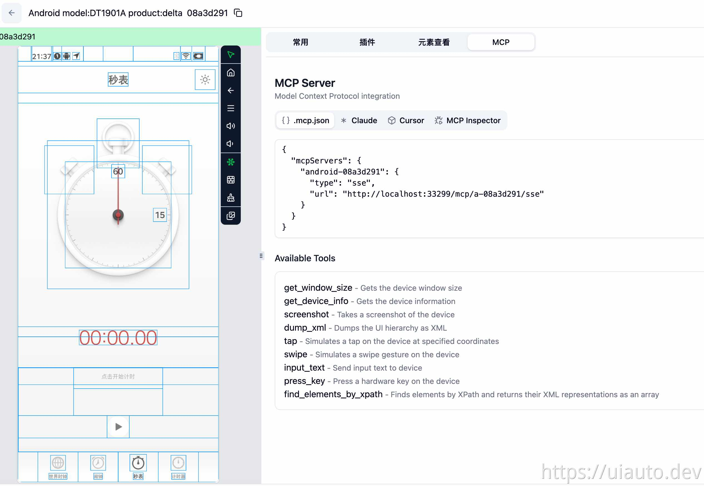

> **English version:** [README_EN.md](README_EN.md)

## 简介

[](https://www.npmjs.com/package/uiautodev)

uiautodev 是专注于**移动端控制、自动化与远程真机**的工具，提供桌面应用与服务端两种形态，支持 Android、iOS、鸿蒙（HarmonyOS），帮助开发和测试高效完成设备管理与 UI 自动化。

> **本仓库包含什么：** 本仓库只包含 UIAutoDev 的 npm 相关代码，即负责下载并运行服务端二进制的 `uiautodev` CLI，提供 `npx uiautodev` 的使用方式。UIAutoDev 核心（桌面应用与服务端）**尚未开源**。但很多相关项目与插件是开源的，见 [相关项目与插件](#相关项目与插件)。



## 快速开始

无需安装，复制下面的命令即可运行（首次会自动下载对应平台的服务端二进制）：

```bash
npx uiautodev
```

启动后服务端默认监听 `http://127.0.0.1:33299`。

## 仓库结构

| 目录 | 说明 |
|---|---|
| `npm/` | 发布的 `uiautodev` npm 包：CLI 源码、测试与包元数据 |
| `images/` | 文档中使用的图片 |

UIAutoDev 核心不在本仓库中，且尚未开源。

## 发布

推送到 `master` 会触发 [Release workflow](.github/workflows/release.yml)：运行测试、更新 `npm/package.json` 中的版本号、提交并打 tag、创建 GitHub Release，并触发 [npm 发布 workflow](.github/workflows/publish.yml)。版本号根据自上次升版以来的 [Conventional Commits](https://www.conventionalcommits.org/) 自动推断：`feat` → minor，`fix`/`perf`/`revert` → patch，破坏性变更 → major。`docs`、`chore`、`ci` 等不会触发发布。

也可以在 Actions 中手动运行 Release workflow 并指定升级类型。在提交信息中加上 `[skip release]` 可跳过发布。

## CLI

| 命令 / 参数 | 说明 |
|---|---|
| `run` | 下载（如需）并运行服务端二进制（默认命令），之后参数原样透传 |
| `download` | 仅下载，打印二进制路径 |
| `path` | 仅打印二进制路径，不下载 |
| `create <name>` | 从模板创建新的插件项目（会提示选择模板；用 `-t, --template <t>` 跳过选择，`-f, --force` 替换（清空并重新生成）已存在的目录） |
| `--version <v>` | 指定版本（默认最新） |
| `--force` | 忽略缓存，强制重新下载 |
| `--help` | 显示帮助 |

二进制缓存于 `~/.cache/uiautodev/<version>/`，可用环境变量 `UIAUTODEV_CACHE_DIR` 覆盖。

```bash
npx uiautodev                       # 下载最新版服务端并运行
npx uiautodev run -addr :8000       # 运行并透传参数（监听 :8000）
npx uiautodev --version 0.6.0 run   # 指定版本
npx uiautodev download              # 仅下载，打印二进制路径
npx uiautodev download --force      # 强制重新下载
npx uiautodev create my-plugin      # 从模板创建插件项目
npx uiautodev create my-plugin -t preact           # 指定模板
npx uiautodev create my-plugin -t preact --force   # 替换已存在的目录
```

## 下载

编译后的安装包可从以下地址下载：

[https://get.uiauto.dev](https://get.uiauto.dev)

## 文档

https://www.yuque.com/codeskyblue/uiautodev

## 反馈

我们通过 [GitHub Issues](https://github.com/uiautodev/uiautodev/issues) 收集 UIAutoDev 的反馈意见。Bug 报告、功能需求、插件想法以及其他建议都欢迎提交，请尽量附上平台信息、UIAutoDev 版本和相关日志。

## 相关项目与插件

核心尚未开源，但很多相关项目与插件是开源的。插件仓库与模板位于 [github.com/uiautodev-plugins](https://github.com/uiautodev-plugins)。

- [uiautodev-plugins](https://github.com/uiautodev-plugins) 官方开源插件模板与插件
- [dictlog](https://github.com/uiautodev/dictlog) 结构化的 Python 日志库，兼容标准库 `logging`
- [uiautoagent](https://github.com/uiautodev/uiautoagent) 使用 AI 控制手机完成任务

## 许可证

基于 [MIT License](LICENSE) 发布。
